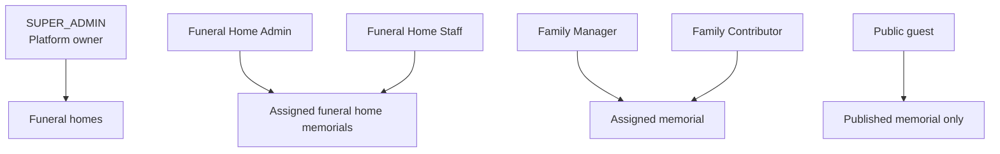
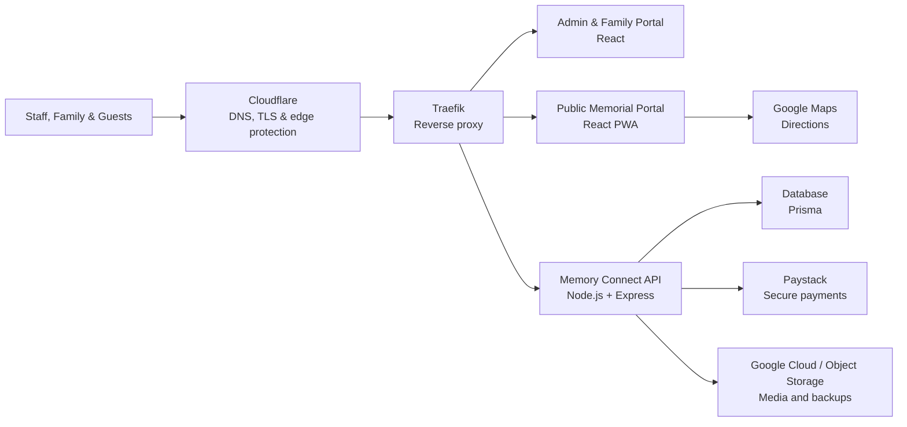
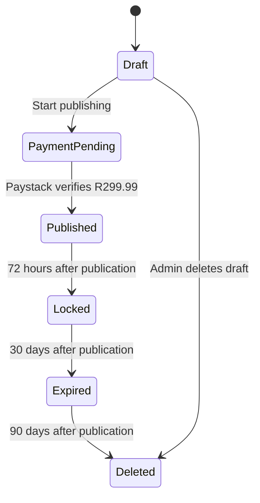

# Memory Connect

**Professional Funeral Operations & Digital Memorial Platform**

Memory Connect is a comprehensive funeral home platform that combines digital memorials with real operational tools. It helps funeral homes create, publish, and share dignified digital memorials while managing their marketing, vehicles, assets, and funeral-day logistics from one system — turning Memory Connect into a complete Funeral Operations Platform, not just a digital memorial service.

## Introduction

Memory Connect is designed for:

- Funeral home owners who need visibility across their business.
- Office administrators and receptionists who prepare memorials.
- Funeral home staff who assist families and manage services.
- Family managers and contributors who provide approved content.
- Guests who open a public memorial from a link or QR code.

### Business Benefits

| Benefit | What It Means |
|---|---|
| Faster preparation | Create and update a funeral programme from one place. |
| Better family service | Invite family members to contribute without giving them billing or publishing access. |
| Easier sharing | Share one public link and QR code across notices, printed programmes, and WhatsApp. |
| Fewer direction queries | Add accurate service locations and Google Maps directions. |
| Consistent branding | Apply the funeral home's logo, colours, contact details, and visual style. |
| Clear oversight | Monitor memorials, payments, public views, and account activity. |
| Respectful privacy | Public viewing ends after 30 days and retained memorial data is removed after 90 days. |
| Market your services | Publish digital brochures and promotions on your own funeral home services page. |
| Run your operations | Manage hearses, service vehicles, and reusable equipment from one screen. |
| Plan each funeral | Reserve vehicles and assets per memorial with double-booking protection. |

## Features

### Memorial & Family Experience

- **Funeral Home Management** - Manage the funeral home profile, staff, memorials, and activity.
- **Family Collaboration** - Give assigned family members controlled access to contribute content.
- **QR Codes** - Generate a QR code that opens the published memorial.
- **Online Memorials** - Present approved service information on phones, tablets, and computers.
- **Obituaries** - Write and maintain a respectful obituary or biography.
- **Funeral Programme** - Build the order of service and control live programme progress.
- **GPS Directions** - Add home, church, cemetery, reception, and other map locations.
- **Photo Gallery** - Upload and organise family photographs.
- **Tribute Messages** - Allow guests and authorised users to view approved tributes.
- **Branding** - Apply logos, colours, typography, social links, and funeral home identity.
- **Analytics** - View unique public visits and memorial performance.
- **Payments** - Publish securely through Paystack for a once-off fee of **R299.99**.
- **Family Invitations** - Invite Family Managers and Family Contributors by link, email, or WhatsApp.
- **Funeral Feedback** - Collect attendee ratings on overall experience, staff, organisation, and venue. Capture contact requests and convert enquiries into new business. See [Funeral Feedback documentation](docs/10-funeral-feedback.md).
- **Platform Oversight** - Give SUPER_ADMIN users an owner dashboard for revenue, support, and audit activity.

### Marketing Hub

Give the funeral home its own public services page and grow enquiries:

- **Marketing Dashboard** - Overview of brochure views, QR scans, and enquiry activity.
- **Digital Brochures** - Build packages and service brochures with cover images, PDFs, photo galleries, call-to-action buttons, and SEO fields. Each brochure gets its own public page at `/services/{slug}` and a printable QR code.
- **Brochure Categories** - Organise brochures into categories such as Funeral Packages, Burials, and Cremations.
- **Promotions** - Announce seasonal offers and specials with banners and date ranges.
- **Branches** - Show each branch with contact details, GPS coordinates, opening hours, and Google Maps links.
- **Contact Information** - Publish phone, WhatsApp, email, and social links for the funeral home.
- **Enquiries** - Collect and manage lead enquiries submitted from brochures.
- **Analytics** - Track page views, unique visitors, QR scans, PDF downloads, and conversions over time.
- **Public Services Page** - Every funeral home gets a public page at `/fh/{slug}`, and memorials link to it with a "Services from {Funeral Home}" section.

### Operations (Vehicle & Asset Management)

Manage the physical resources behind every funeral:

- **Vehicle Management** - Track hearses, family cars, minibuses, trucks, and utility vehicles. Record registration numbers, specs, insurance, roadworthy and license-disk expiries, assigned drivers, service history, fuel logs, maintenance logs, and vehicle photos with reminders for renewals.
- **Asset Management** - Track reusable equipment (tents, chairs, tables, stretchers, sound systems, generators, and more) with serial numbers, purchase and warranty details, QR codes per asset, movement history, branch transfers, and damage reports.
- **Funeral Resources** - Reserve vehicles and assets against each memorial from a single planning screen, with an availability check that prevents double booking and a check-in/check-out workflow for funeral day.
- **Vehicle Calendar** - Each vehicle shows its upcoming services and reservations so nothing is double-booked.

### Feature Management & Release Management

Platform owners control exactly who sees what, and when:

- **Feature Registry** - Every capability (memorials, live stream, vehicles, assets, insurance, CRM, and more) is a registered feature with a name, category, release channel, and rollout percentage.
- **Release Channels** - Features move through `INTERNAL`, `QA`, `BETA`, `EARLY_ACCESS`, `GENERAL_AVAILABILITY`, `DEPRECATED`, and `DISABLED`, gated by the viewer's role.
- **Subscription Gating** - Each feature can require a minimum edition (`MEMORIAL`, `FUNERAL_OFFICE`, `ENTERPRISE`, `WHITE_LABEL`) and subscription plan (`STARTER` → `ENTERPRISE`).
- **Rollout Control** - Ship a feature to 0%, 5%, 10%, 25%, 50%, 75%, or 100% of funeral homes with deterministic per-home sampling.
- **Feature Dependencies** - A feature can require other features (e.g. CASE_MANAGEMENT requires MEMORIALS); the child stays hidden until every dependency resolves enabled, with circular dependencies rejected at both the API and the resolution engine.
- **Per-Home & Per-User Overrides** - Force-enable or deny a feature for a specific funeral home or user, including early-access opt-ins and expiry dates.
- **Feature Tester** - SUPER_ADMIN can preview the resolved feature set as any funeral home to verify gating.
- **Audit Trail** - Every feature change (create, update, enable, disable, override) is logged with the acting user.
- **Server-Side Evaluation** - The API resolves features and the admin sidebar auto-hides disabled capabilities for the signed-in account.

## Product Roles



| Role | Main Access |
|---|---|
| SUPER_ADMIN | Platform overview, funeral homes, payments, users, support, analytics, audit logs, and feature management. |
| Funeral Home Admin | Funeral home profile, memorial creation, family invitations, payments, and publishing. |
| Funeral Home Staff | Funeral home memorial workflow as permitted by the organisation. |
| Family Manager | Assigned memorial content, photos, locations, programme, tributes, and preview. |
| Family Contributor | Suggestions and uploads for assigned memorials, plus tributes and preview. |
| Public Guest | Published content only. No editing or administration controls. |

## System Architecture



### Application Components

| Component | Purpose | Local Address |
|---|---|---|
| Admin Portal | Funeral home, family, and platform owner workflows | `http://localhost:5173` |
| Memorial Portal | Public memorial, projector, and funeral home services experience | `http://localhost:5174` |
| API | Authentication, memorials, payments, marketing, operations, analytics, and permissions | `http://localhost:4000` |
| Database | Users, funeral homes, memorials, payments, invitations, brochures, vehicles, assets, and audit records | Prisma-managed |

**API route groups (all under `/api/v1`):**

| Group | Purpose |
|---|---|
| `/auth` | Login, registration, and funeral home profile |
| `/memorials` | Memorial CRUD, publishing, preview tokens, photos, and locations |
| `/public` | Public memorial and funeral home marketing pages |
| `/payments` | Paystack payment initialisation and verification |
| `/marketing` | Brochures, categories, promotions, branches, contact, enquiries, and analytics |
| `/vehicles` | Vehicle CRUD, photos, service history, fuel log, and maintenance |
| `/assets` | Asset CRUD, photos, movements, damage reports, and QR codes |
| `/funeral-resources` | Vehicle/asset reservations per memorial and availability checks |
| `/platform/features` | SUPER_ADMIN feature registry, rollout, overrides, resolution preview, and audit log |
| `/platform` | SUPER_ADMIN owner dashboard, payments, users, support, and audit logs |

> **Note:** Production infrastructure can place Cloudflare and Traefik in front of the applications and use Google Cloud or compatible object storage for media and backups. Local development uses the configured local database and upload directory.

## Memorial Lifecycle



## Documentation

The complete end-user training manual is in [`docs/README.md`](docs/README.md).

| Guide | Audience |
|---|---|
| [Getting Started](docs/01-getting-started.md) | All users |
| [Funeral Home Setup](docs/02-funeral-home-setup.md) | Owners and administrators |
| [Branding](docs/03-branding.md) | Owners and administrators |
| [Create a Memorial](docs/04-create-memorial.md) | Funeral home staff |
| [Family Management](docs/05-family-management.md) | Staff and family |
| [Publishing](docs/06-publishing.md) | Funeral home administrators |
| [Payments](docs/07-payments.md) | Funeral home owners and administrators |
| [Public Memorial](docs/08-public-memorial.md) | Staff, family, and guests |
| [Analytics](docs/09-analytics.md) | Owners and administrators |
| [Owner Dashboard](docs/10-owner-dashboard.md) | Platform owner |
| [Marketing Hub](docs/13-marketing-hub.md) | Owners and administrators |
| [Vehicles & Assets](docs/14-vehicles-and-assets.md) | Owners and administrators |
| [Funeral Resources](docs/15-funeral-resources.md) | Owners, administrators, and staff |
| [Feature Management](docs/16-feature-management.md) | Platform owner |
| [Troubleshooting](docs/11-troubleshooting.md) | All users |
| [Frequently Asked Questions](docs/12-faq.md) | All users |

## Local Development

### Requirements

- Node.js 20 or newer
- npm

### Start the Platform

```bash
npm install
cp .env.example .env
cp .env.example apps/api/.env
npm run db:push
npm run dev
```

The services print their local and network addresses in the terminal.

## Production Deployment

After pulling the updated branch on the VM, rebuild the containers, sync Prisma, seed the permanent demo, and restart the services:

```bash
cd /home/pitso4u/apps/MemoryConnect

docker compose -f docker-compose.prod.yml up -d --build \
  memoryconnect-api memoryconnect-public memoryconnect-admin

docker exec memoryconnect-api sh -c "npx prisma db push"
docker exec memoryconnect-api sh -c "npm run seed:demo"

docker compose -f docker-compose.prod.yml restart \
  memoryconnect-api memoryconnect-public memoryconnect-admin
```

Purge Cloudflare cache for `/`, `/demo`, `/manifest.webmanifest`, and `/brand/*`. Test in a private browser. If a test device still shows the old shell or old logo, unregister the old service worker once from browser dev tools, then reload.

Production verification checklist:

```bash
curl -I https://memoryconnect.co.za/brand/memory-connect-logo-horizontal.png
curl -I https://memoryconnect.co.za/brand/memory-connect-emblem.png
curl -I https://memoryconnect.co.za/brand/memory-connect-og-1200x630.png
curl -I https://memoryconnect.co.za/manifest.webmanifest
curl -I https://memoryconnect.co.za/brand/memory-connect-icon-192.png
curl -I https://memoryconnect.co.za/brand/memory-connect-icon-512.png
```

Each logo/icon request should return `200`, `Content-Type: image/png`, and a non-zero `Content-Length`. The manifest should return `200` with `application/manifest+json` or JSON-compatible content type.

## Security Principles

- Passwords are never displayed to administrators or platform owners.
- Password reset links are used instead of revealing credentials.
- Family users can access only memorials assigned to them.
- Public pages contain no admin or family controls.
- Platform actions are restricted to SUPER_ADMIN and recorded in audit logs.
- Paystack payment status is verified by the server.
- Raw visitor IP addresses are not stored for memorial analytics.

## License

Proprietary software. Copyright Pitso Soetsang.
