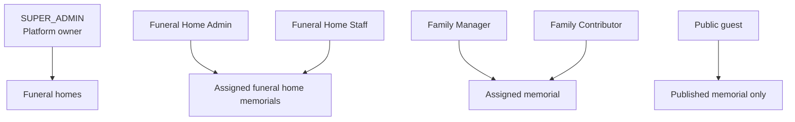
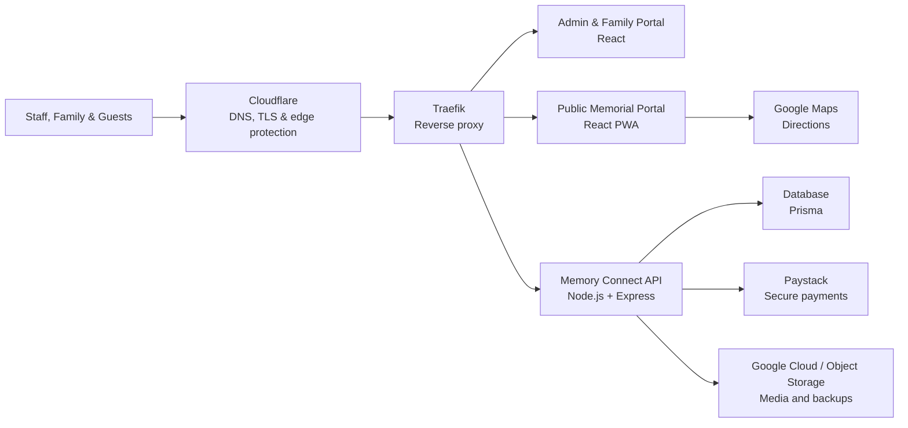
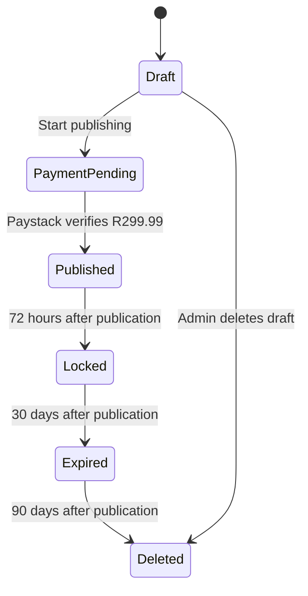

# Memory Connect

**Professional Digital Funeral & Memorial Management Platform**

Memory Connect helps funeral homes create, publish, and share dignified digital memorials. It brings the obituary, funeral programme, photographs, venue directions, tribute messages, and family collaboration into one simple service.

## Introduction

Memory Connect is designed for:

- Funeral home owners who need visibility across their business.
- Office administrators and receptionists who prepare memorials.
- Funeral home staff who assist families and manage services.
- Family managers and contributors who provide approved content.
- Guests who open a public memorial from a link or QR code.

### Business Benefits

| Benefit | What It Means |
|---|---|
| Faster preparation | Create and update a funeral programme from one place. |
| Better family service | Invite family members to contribute without giving them billing or publishing access. |
| Easier sharing | Share one public link and QR code across notices, printed programmes, and WhatsApp. |
| Fewer direction queries | Add accurate service locations and Google Maps directions. |
| Consistent branding | Apply the funeral home's logo, colours, contact details, and visual style. |
| Clear oversight | Monitor memorials, payments, public views, and account activity. |
| Respectful privacy | Public viewing ends after 30 days and retained memorial data is removed after 90 days. |

## Features

- **Funeral Home Management** - Manage the funeral home profile, staff, memorials, and activity.
- **Family Collaboration** - Give assigned family members controlled access to contribute content.
- **QR Codes** - Generate a QR code that opens the published memorial.
- **Online Memorials** - Present approved service information on phones, tablets, and computers.
- **Obituaries** - Write and maintain a respectful obituary or biography.
- **Funeral Programme** - Build the order of service and control live programme progress.
- **GPS Directions** - Add home, church, cemetery, reception, and other map locations.
- **Photo Gallery** - Upload and organise family photographs.
- **Tribute Messages** - Allow guests and authorised users to view approved tributes.
- **Branding** - Apply logos, colours, typography, social links, and funeral home identity.
- **Analytics** - View unique public visits and memorial performance.
- **Payments** - Publish securely through Paystack for a once-off fee of **R299.99**.
- **Family Invitations** - Invite Family Managers and Family Contributors by link, email, or WhatsApp.
- **Funeral Feedback** - Collect attendee ratings on overall experience, staff, organisation, and venue. Capture contact requests and convert enquiries into new business. See [Funeral Feedback documentation](docs/10-funeral-feedback.md).
- **Platform Oversight** - Give SUPER_ADMIN users an owner dashboard for revenue, support, and audit activity.

## Product Roles



| Role | Main Access |
|---|---|
| SUPER_ADMIN | Platform overview, funeral homes, payments, users, support, analytics, and audit logs. |
| Funeral Home Admin | Funeral home profile, memorial creation, family invitations, payments, and publishing. |
| Funeral Home Staff | Funeral home memorial workflow as permitted by the organisation. |
| Family Manager | Assigned memorial content, photos, locations, programme, tributes, and preview. |
| Family Contributor | Suggestions and uploads for assigned memorials, plus tributes and preview. |
| Public Guest | Published content only. No editing or administration controls. |

## System Architecture



### Application Components

| Component | Purpose | Local Address |
|---|---|---|
| Admin Portal | Funeral home, family, and platform owner workflows | `http://localhost:5173` |
| Memorial Portal | Public memorial and projector experience | `http://localhost:5174` |
| API | Authentication, memorials, payments, analytics, and permissions | `http://localhost:4000` |
| Database | Users, funeral homes, memorials, payments, invitations, and audit records | Prisma-managed |

> **Note:** Production infrastructure can place Cloudflare and Traefik in front of the applications and use Google Cloud or compatible object storage for media and backups. Local development uses the configured local database and upload directory.

## Memorial Lifecycle



## Documentation

The complete end-user training manual is in [`docs/README.md`](docs/README.md).

| Guide | Audience |
|---|---|
| [Getting Started](docs/01-getting-started.md) | All users |
| [Funeral Home Setup](docs/02-funeral-home-setup.md) | Owners and administrators |
| [Branding](docs/03-branding.md) | Owners and administrators |
| [Create a Memorial](docs/04-create-memorial.md) | Funeral home staff |
| [Family Management](docs/05-family-management.md) | Staff and family |
| [Publishing](docs/06-publishing.md) | Funeral home administrators |
| [Payments](docs/07-payments.md) | Funeral home owners and administrators |
| [Public Memorial](docs/08-public-memorial.md) | Staff, family, and guests |
| [Analytics](docs/09-analytics.md) | Owners and administrators |
| [Owner Dashboard](docs/10-owner-dashboard.md) | Platform owner |
| [Troubleshooting](docs/11-troubleshooting.md) | All users |
| [Frequently Asked Questions](docs/12-faq.md) | All users |

## Local Development

### Requirements

- Node.js 20 or newer
- npm

### Start the Platform

```bash
npm install
cp .env.example .env
cp .env.example apps/api/.env
npm run db:push
npm run dev
```

The services print their local and network addresses in the terminal.

## Production Deployment

After pulling the updated branch on the VM, rebuild the containers, sync Prisma, seed the permanent demo, and restart the services:

```bash
cd /home/pitso4u/apps/MemoryConnect

docker compose -f docker-compose.prod.yml up -d --build \
  memoryconnect-api memoryconnect-public memoryconnect-admin

docker exec memoryconnect-api sh -c "npx prisma db push"
docker exec memoryconnect-api sh -c "npm run seed:demo"

docker compose -f docker-compose.prod.yml restart \
  memoryconnect-api memoryconnect-public memoryconnect-admin
```

Purge Cloudflare cache for `/`, `/demo`, `/manifest.webmanifest`, and `/brand/*`. Test in a private browser. If a test device still shows the old shell or old logo, unregister the old service worker once from browser dev tools, then reload.

Production verification checklist:

```bash
curl -I https://memoryconnect.co.za/brand/memory-connect-logo-horizontal.png
curl -I https://memoryconnect.co.za/brand/memory-connect-emblem.png
curl -I https://memoryconnect.co.za/brand/memory-connect-og-1200x630.png
curl -I https://memoryconnect.co.za/manifest.webmanifest
curl -I https://memoryconnect.co.za/brand/memory-connect-icon-192.png
curl -I https://memoryconnect.co.za/brand/memory-connect-icon-512.png
```

Each logo/icon request should return `200`, `Content-Type: image/png`, and a non-zero `Content-Length`. The manifest should return `200` with `application/manifest+json` or JSON-compatible content type.

## Security Principles

- Passwords are never displayed to administrators or platform owners.
- Password reset links are used instead of revealing credentials.
- Family users can access only memorials assigned to them.
- Public pages contain no admin or family controls.
- Platform actions are restricted to SUPER_ADMIN and recorded in audit logs.
- Paystack payment status is verified by the server.
- Raw visitor IP addresses are not stored for memorial analytics.

## License

Proprietary software. Copyright Pitso Soetsang.
