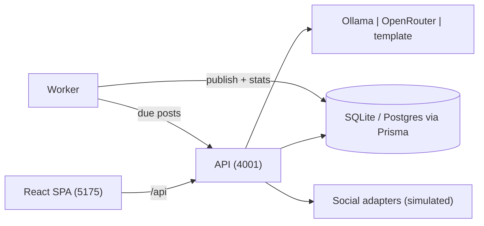

# SmartReach AI

**Connect your business once. AI creates, schedules, and publishes your marketing automatically.**

SmartReach AI is a multi-tenant AI marketing automation platform. It reads your business's real sources (website, blog, products, events, announcements, memorials, promotions), generates platform-ready content, schedules it to each connected social account, publishes automatically, and learns from engagement to pick better posting times.

**First customer: MemoryConnect** — when a funeral home publishes a memorial, MemoryConnect can send an event to SmartReach, which generates marketing assets, schedules posts, tracks engagement, and handles follow-up automatically. The same platform later powers marketing for any other product: driving schools, restaurants, churches, plumbers, real estate agents.

---

## What's in this MVP (Phase 1)

| Area | What it does |
|---|---|
| **Auth** | Register, login, JWT access + rotating refresh tokens, RBAC (`SUPER_ADMIN` / `ORG_ADMIN` / `MEMBER`) |
| **Multi-tenancy** | Every workspace is a tenant. Users, business, posts, calendar, leads and analytics are all tenant-scoped. |
| **Business & brand** | Name, industry, website, logo, description, primary/secondary colours, fonts, tone, audience, keywords. |
| **Content sources** | website · blog · products · events · memorials · announcements · promotions (each with label, url, sample content). |
| **AI Generator** | One call produces posts per platform × tone variants (Friendly / Professional / Luxury / Modern). |
| **AI providers** | **Ollama** (local) or **OpenRouter** (hosted) via an OpenAI-compatible endpoint, with a deterministic **template** fallback that runs offline. |
| **Calendar & scheduling** | Approve a post, pick a slot (or accept the platform's suggested time), and it lands in the calendar. |
| **Worker** | Polls for due posts and publishes them automatically, writing simulated engagement snapshots. |
| **Manual publish** | "Publish now" for instant posting. |
| **Marketing Brain** | Daily reach chart, per-platform performance, engagement rate, and learned best-times. |
| **Leads** | Capture leads from comments/forms; status pipeline (NEW → CONTACTED → QUALIFIED → WON/LOST). |
| **Connected accounts** | 8 platforms with connect/disconnect and handles (simulated OAuth for the MVP). |

## Architecture

```
smartreach-ai/
├─ apps/
│  ├─ api/        Express + Prisma API (port 4001)        @smartreach/api
│  ├─ worker/     Publishing worker (polls due posts)     @smartreach/worker
│  └─ web/        React 19 + Vite + Tailwind SPA (5175)   @smartreach/web
└─ packages/
   ├─ ai/         Ollama / OpenRouter / template generator
   ├─ common/     Shared types + constants
   ├─ social/     Publish adapters (simulated now, real platforms in Phase 2+)
   ├─ scheduler/  Default slots, next-time-for, best-time learning
   ├─ analytics/  Daily aggregation, platform performance, engagement rate
   └─ publish/    Shared publish pipeline used by API + worker
```



## Quick start

Requirements: Node 20+ and npm.

```bash
cd smartreach-ai
npm install
cp .env.example .env
npm run db:push        # create SQLite db
npm run seed:demo      # seed the MemoryConnect demo tenant
npm run dev            # api (4001) + worker + web (5175)
```

Open **http://localhost:5175** and sign in with the demo account:

```
demo@memoryconnect.co.za
DemoPass123!
```

Or create your own workspace from the login screen (this also demonstrates multi-tenancy).

### Using a real AI provider

By default `AI_PROVIDER=template`, so the demo runs with zero external keys. To use a real LLM, edit `.env`:

```bash
# Local model via Ollama (https://ollama.com)
AI_PROVIDER=ollama
OLLAMA_BASE_URL=http://localhost:11434
OLLAMA_MODEL=llama3.1

# Hosted model via OpenRouter (https://openrouter.ai)
AI_PROVIDER=openrouter
OPENROUTER_API_KEY=sk-or-...
OPENROUTER_MODEL=openai/gpt-4o-mini
```

`AI_PROVIDER_FALLBACK=template` keeps the pipeline alive if the provider is unreachable. Ollama and OpenRouter are both OpenAI-compatible, so the client is shared.

### Commands

| Command | Purpose |
|---|---|
| `npm run dev` | Run api + worker + web together |
| `npm run dev:api` / `dev:worker` / `dev:web` | Run one service |
| `npm run db:push` | Sync the Prisma schema to the database |
| `npm run seed:demo` | (Re)seed the MemoryConnect demo tenant |
| `npm run build` | Build packages then all apps |
| `npm run typecheck` | Type-check packages + apps |

## API overview (all under `/api/v1`)

| Group | Routes |
|---|---|
| `/auth` | `POST /register`, `POST /login`, `POST /refresh`, `POST /logout`, `GET /me` |
| `/business` | `GET /`, `PUT /` (profile + brand) |
| `/content-sources` | `GET/POST/`, `PUT/DELETE /:id` |
| `/connections` | `GET /`, `POST /connect`, `POST /disconnect` |
| `/posts` | `GET /`, `POST /generate`, `POST /:id/approve`, `POST /:id/schedule`, `POST /:id/publish`, `DELETE /:id`, `GET /:id/suggest-time` |
| `/calendar` | `GET /`, `POST /:id/cancel` |
| `/dashboard` | `GET /` (overview stats) |
| `/analytics` | `GET /overview?days=`, `GET /platforms`, `GET /best-times` |
| `/leads` | `GET /`, `POST /`, `PATCH /:id/status`, `DELETE /:id` |
| `/users` | `GET /`, `POST /invite` |

## Data model (Prisma)

`User` · `RefreshToken` · `Tenant` · `TenantUser` · `Business` · `ContentSource` · `ConnectedAccount` · `Post` · `ScheduledPost` · `Lead` · `StatSnapshot`

The datasource is **SQLite** for zero-config local development. To move to PostgreSQL, change `datasource db` in `apps/api/prisma/schema.prisma` to `provider = "postgresql"` and point `DATABASE_URL` at a Postgres instance (fields are already portable — IDs are strings, keywords are stored as JSON).

## Marketing Brain

Every publish writes a `StatSnapshot` with reach, visits, clicks, shares, conversions, followers, weekday and hour. The Brain aggregates these into the daily chart, ranks platforms, and computes the top `(day, hour)` slots. Until enough data exists (`learned: false`), SmartReach falls back to the default slot plan in `packages/scheduler`. Real engagement data from live platform APIs replaces the simulated snapshots in Phase 2.

## Roadmap (as designed)

- **Phase 1 (this MVP):** Auth · multi-tenancy · business profiles · AI generation · calendar · manual publishing
- **Phase 2:** Facebook / LinkedIn / Google Business / X integrations + real analytics
- **Phase 3:** Instagram / TikTok / YouTube publishing · AI images · AI video
- **Phase 4:** CRM · lead scoring · email campaigns · WhatsApp automation · insights · A/B testing

### MemoryConnect → SmartReach API

Later, MemoryConnect plugs in through the SmartReach API:

```
MemoryConnect ──new memorial published──▶ SmartReach API ──▶ AI Content / Images / Scheduling / Publishing / Email / Analytics / CRM
```

## License

Proprietary software. Copyright Pitso Soetsang.
