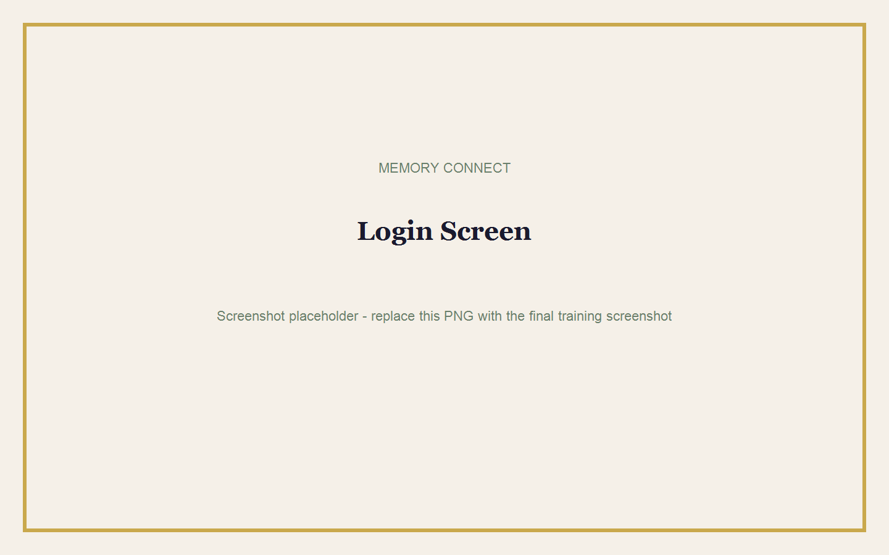
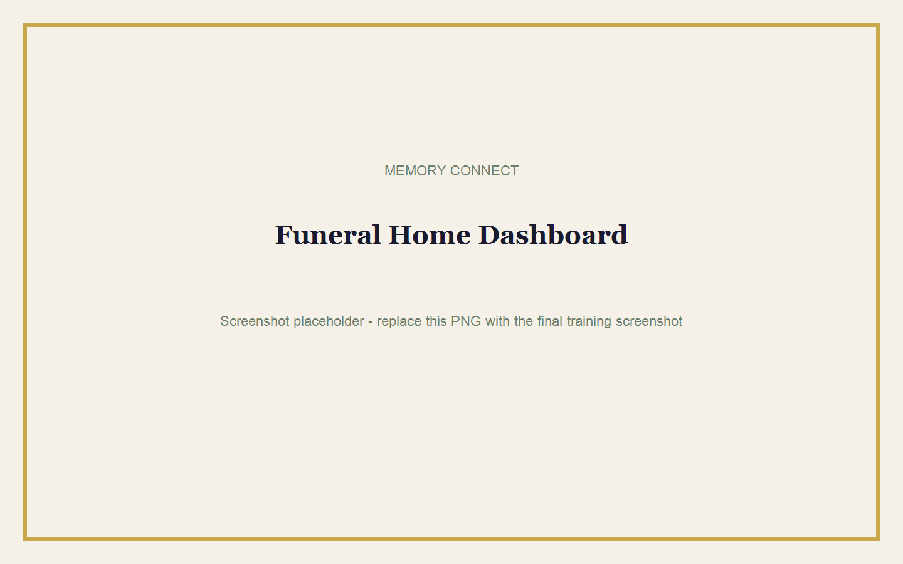

# Getting Started

## Goal

Sign in safely, understand the dashboard, manage your password, and sign out.

**Estimated time:** 10 minutes  
**Requirements:** Your Memory Connect email address, password or invitation link, and internet access.

## Logging In

1. Open the Memory Connect Admin Portal in your browser.
2. Enter your email address.
3. Enter your password.
4. Select **Sign In**.
5. Wait for your correct dashboard to open.

| Your Role | First Screen |
|---|---|
| Funeral Home Admin or Staff | Memorials dashboard |
| Family Manager or Contributor | Assigned memorials |
| SUPER_ADMIN | Platform Overview |

> **Tip:** Save the correct portal address as a browser favourite. Do not save your password on a shared reception computer.

### Common Mistakes

- Adding a space before or after the email address.
- Using the invitation link as a password.
- Signing in with another staff member's account.
- Opening an expired family invitation.

## Changing or Resetting Your Password

Memory Connect never shows an existing password.

1. Ask your funeral home administrator or the platform owner for a password reset link.
2. Open the reset link sent to you.
3. Enter a new private password.
4. Confirm the new password.
5. Sign in with the new password.

> **Warning:** Never send your password by WhatsApp, email, or SMS. Send only the secure reset link.

## Understanding the Dashboard

The left menu shows the areas available to your role. On a phone, select the menu icon at the top.

| Menu Item | Purpose |
|---|---|
| Memorials | View and open memorials. |
| New Memorial | Start a new draft. |
| Billing or Payments | Review publishing payments. |
| Profile & Branding | Update funeral home identity. |
| Family | Open assigned memorials. |
| Platform Overview | Monitor the full platform as SUPER_ADMIN. |

## Logging Out

1. Find your name at the bottom of the menu.
2. Select **Sign out**.
3. Confirm that the login screen appears.

> **Best Practice:** Always sign out when using a shared office or reception computer.

## Notes

- The system displays only the areas your role may use.
- A `403` message means your account does not have permission for that area.
- If your funeral home is suspended, contact Memory Connect support.

## Quick Check

- [ ] I can sign in.
- [ ] I know which dashboard belongs to my role.
- [ ] I know how to request a reset link.
- [ ] I can sign out.
