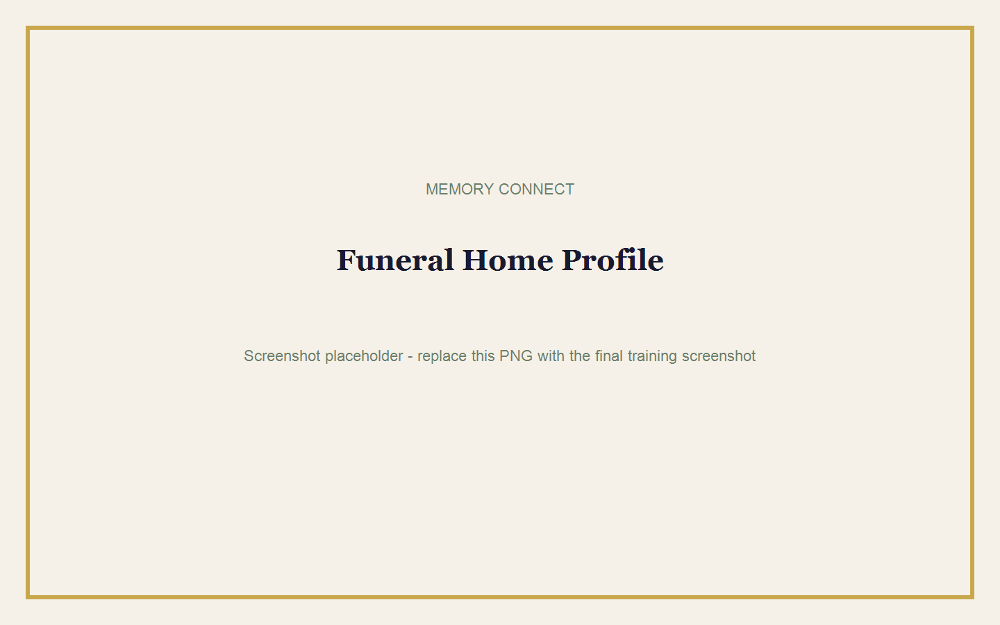

# Funeral Home Owner Guide

## Goal

Prepare the funeral home account for daily use and understand owner responsibilities.

**Estimated time:** 20 minutes  
**Requirements:** Funeral Home Admin access and the organisation's official contact details.

## Initial Setup

1. Sign in as the Funeral Home Admin.
2. Open **Profile & Branding**.
3. Confirm the legal or company name.
4. Add the trading name used by families.
5. Add the office email, telephone number, WhatsApp number, and address.
6. Add official website and social links where available.
7. Save the profile.

> **Note:** Accurate contact details appear across the funeral home's branded experience.

## Owner Responsibilities

| Area | Owner Responsibility |
|---|---|
| Users | Ensure each staff member uses an individual account. |
| Branding | Approve logos, colours, wording, and contact details. |
| Memorials | Confirm content is respectful and belongs to the correct family. |
| Payments | Review references and successful payment status. |
| Publishing | Approve the final memorial before payment. |
| Reports | Review memorial counts, payments, and public views. |
| Privacy | Remove test content and avoid unnecessary personal information. |

## Managing Staff

The current profile lists funeral home users. Staff account creation or role changes must be completed by an authorised administrator or Memory Connect platform support.

1. Open **Profile & Branding** or the available staff area.
2. Review the names and email addresses shown.
3. Report duplicate, incorrect, or former staff accounts to the authorised administrator.
4. Request a password reset link when a staff member cannot sign in.

> **Warning:** Do not share one administrator password among several employees.

## Managing Memorials

1. Open **Memorials**.
2. Use the status filters to find Draft, Payment Pending, Published, Locked, or Expired memorials.
3. Open a memorial to review its full details.
4. Confirm the deceased name and service information before editing.

## Payments and Publishing

- Drafts are free.
- Publishing costs **R299.99 once per memorial**.
- Payment is completed securely through Paystack.
- Public viewing lasts 30 days.
- Editing locks 72 hours after publication.

See [Publishing](06-publishing.md) and [Payments](07-payments.md).

## Reports and Analytics

Use memorial analytics to check unique public views. Refreshing the same memorial repeatedly in one browser does not create repeated views within the same day.

See [Analytics](09-analytics.md).

## Best Practices

- Use clear staff names instead of shared names such as "Office".
- Check spelling with the family before publishing.
- Test every map location and QR code.
- Keep payment references with the service record.
- Preview the memorial on both a phone and a computer.

## Common Mistakes

- Entering the family's email as the funeral home's main email.
- Using an unofficial logo image.
- Publishing before all locations and programme items are checked.
- Assuming family contributors can publish or make payments.
