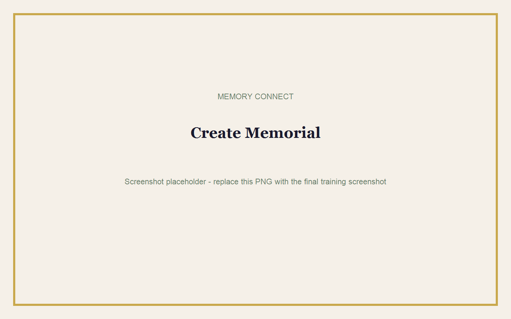
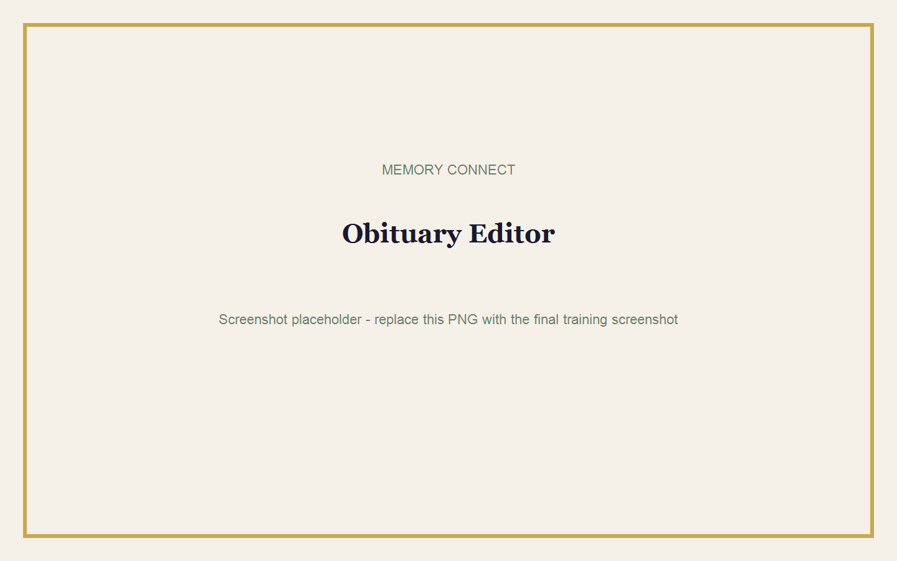
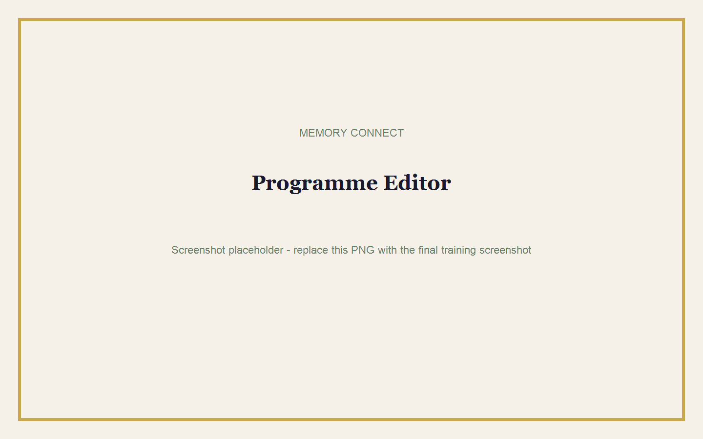
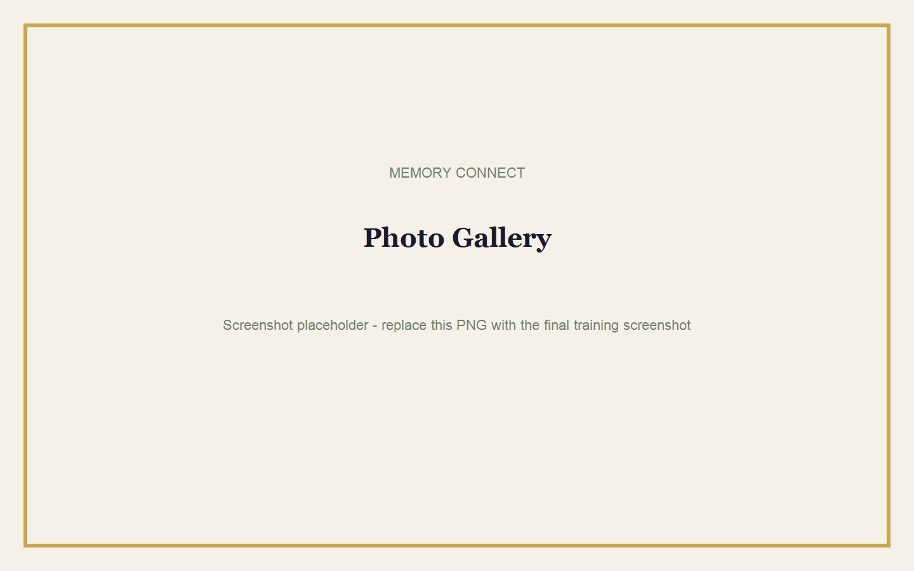
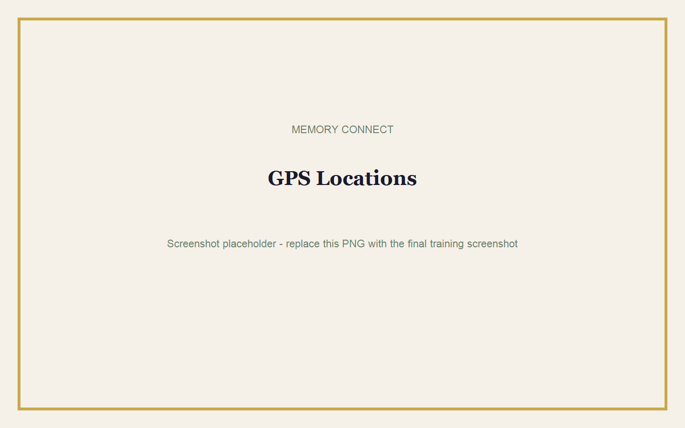

# Create Your First Memorial

## Goal

Create a complete draft memorial with service information, obituary, programme, photos, and directions.

**Estimated time:** 30-45 minutes  
**Requirements:** Funeral Home Admin or authorised staff access, approved family information, photographs, and venue details.

## Step 1: Start a Draft

1. Sign in.
2. Select **New Memorial**.
3. Enter the full name of the deceased.
4. Add the service date and time.
5. Add the main service venue.
6. Select **Create & Continue**.

> **Tip:** Drafts are free. Create the draft early and publish only after the family approves it.

## Step 2: Write the Obituary

1. Open the **Obituary** section.
2. Enter the approved obituary or biography.
3. Check names, dates, places, and family relationships.
4. Save the changes.

### Example Structure

1. Full name and important dates.
2. Place of birth and early life.
3. Family, work, faith, community, and achievements.
4. Closing remembrance.

> **Warning:** Do not include private identity numbers, banking details, or unapproved medical information.

## Step 3: Create the Funeral Programme

1. Open **Programme**.
2. Add each item in the order it will happen.
3. Use clear titles such as Welcome, Scripture Reading, Eulogy, Tributes, Sermon, and Vote of Thanks.
4. Add the speaker or participant where needed.
5. Reorder and save items.

> **Note:** After the publishing lock time, the programme cannot be edited.

## Step 4: Upload Photos

1. Open **Photos**.
2. Select the upload control.
3. Choose approved images.
4. Add a category or caption where available.
5. Wait until each upload finishes.

### Photo Tips

- Use clear, correctly rotated photographs.
- Prefer smaller web-ready images when internet speed is limited.
- Do not upload the same photo several times.
- Get family approval before publication.

## Step 5: Add GPS Directions

1. Open **Locations**.
2. Select a location type: Family Home, Church, Cemetery, Reception, or Other.
3. Enter the location name.
4. Add the address and useful notes.
5. Enter latitude and longitude, or select **Use my current location** while at the venue.
6. Save the location.
7. Select **Open in Google Maps** and confirm the pin.

> **Warning:** Do not use your current location unless you are physically at the correct venue.

## Step 6: Preview

1. Select **Preview public memorial**.
2. Check the deceased name, dates, obituary, programme, photos, directions, and branding.
3. Ask another staff member or family representative to check the preview.
4. Correct all issues before publishing.

## Deleting a Memorial

Funeral home administrators may delete eligible drafts or unlocked memorials.

1. Open the correct memorial.
2. Confirm the deceased name.
3. Select the delete action.
4. Read the confirmation carefully.
5. Confirm only when deletion is intended.

> **Warning:** Deletion may permanently remove content and uploaded media. Family users cannot delete memorials.

## Common Mistakes

- Creating a duplicate memorial.
- Using the wrong deceased name or service date.
- Leaving locations untested.
- Uploading photos before receiving family approval.
- Publishing before checking the programme order.

## Completion Checklist

- [ ] Basic information is correct.
- [ ] Obituary is approved.
- [ ] Programme order is correct.
- [ ] Photos are approved.
- [ ] All map pins open correctly.
- [ ] Public preview has been checked.
