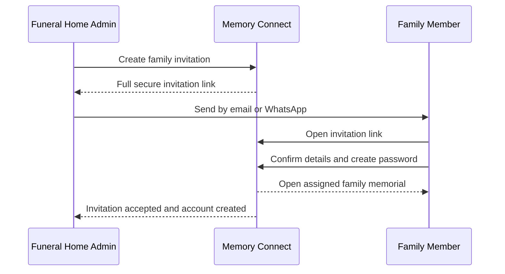
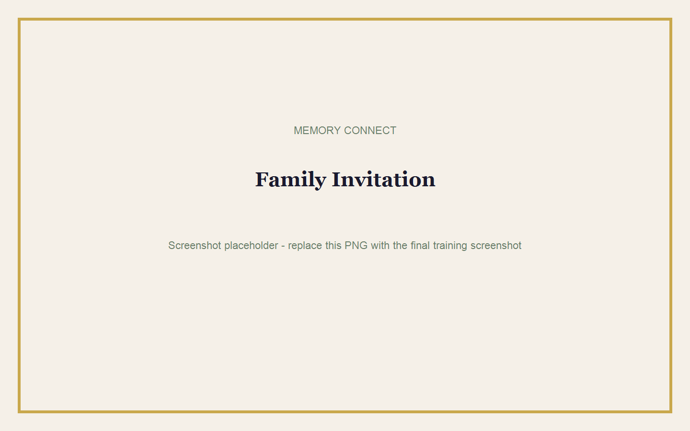

# Family Member Guide

## Goal

Invite family members safely and help them contribute to the correct memorial.

**Estimated time:** 15 minutes for setup; contribution time varies.  
**Requirements:** An existing memorial and the family member's name plus email address or phone number.

## Family Roles

| Capability | Family Manager | Family Contributor |
|---|:---:|:---:|
| View assigned memorial | Yes | Yes |
| Edit obituary or biography | Yes | Submit or suggest |
| Add programme items | Yes, before lock | Suggest |
| Add locations | Yes, before lock | Suggest |
| Upload photos | Yes | Yes |
| View tributes | Yes | Yes |
| Preview public memorial | Yes | Yes |
| Publish or pay | No | No |
| Delete memorial | No | No |
| Access billing or settings | No | No |

## Family Invitation Flow

## For Funeral Home Staff: Invite a Family Member

1. Open the correct memorial.
2. Open the family access or invitation area.
3. Enter the invited person's name.
4. Add an email address, phone number, or both.
5. Choose **Family Manager** or **Family Contributor**.
6. Create the invitation.
7. Select **Copy Link**, **Open Link**, **Share via WhatsApp**, or **Send by Email**.
8. Confirm that the list shows the invitation as Pending.

> **Tip:** Use **Open Link** in a private browser window to confirm the invitation opens before sending it.

## For Family Members: Accept an Invitation

1. Open the invitation link sent by the funeral home.
2. Confirm the funeral home and deceased person's name.
3. Confirm or enter your name and email address.
4. Create a private password.
5. Accept the invitation.
6. Sign in to the Family Portal.

> **Warning:** Do not forward your personal invitation link to another person.

## Upload Photos

1. Open the assigned memorial.
2. Select **Photos**.
3. Choose approved photographs.
4. Add a caption where available.
5. Wait for the upload to finish.

## Write a Biography or Obituary

1. Open **Obituary**.
2. Family Managers may edit the content before the lock.
3. Family Contributors should submit or suggest approved wording.
4. Save the contribution.

## Edit or Suggest Programme Items

1. Open **Programme**.
2. Add or suggest the item title, person responsible, and order.
3. Check names and titles carefully.
4. Save the contribution.

If the memorial is locked, the system displays:

> **This programme is locked because it has already been published and shared.**

## Add Directions

1. Open **Locations**.
2. Choose Family Home, Church, Cemetery, Reception, or Other.
3. Enter the location name and address.
4. Add notes such as gate instructions or arrival time.
5. Add the correct latitude and longitude.
6. Test **Open in Google Maps**.

## View Tributes

1. Open **Tributes**.
2. Read the tribute messages available to your role.
3. Where funeral home policy allows moderation, a Family Manager may assist with approved or hidden suggestions.

## What Family Members Cannot Do

Family members cannot:

- Publish a memorial.
- Start or verify a payment.
- Delete or permanently remove a memorial.
- Access funeral home billing or settings.
- View Paystack information.
- Manage funeral home staff.
- Access other families' memorials.
- Access unrelated analytics.

## Expired Invitations

If an invitation has expired:

1. Contact the funeral home.
2. Ask the administrator to select **Resend Invite**.
3. Use only the newest invitation link.

## Password Help

If a family member forgot the password:

1. Contact the funeral home administrator.
2. Ask for a password reset link.
3. Open the link and choose a new password.

The administrator can see whether a password is set, but can never see the password itself.

## Common Mistakes

- Sending the invitation to the wrong phone number.
- Choosing Contributor when the person needs Manager access.
- Forwarding an expired link.
- Editing the wrong assigned memorial.
- Assuming a family member can publish.
