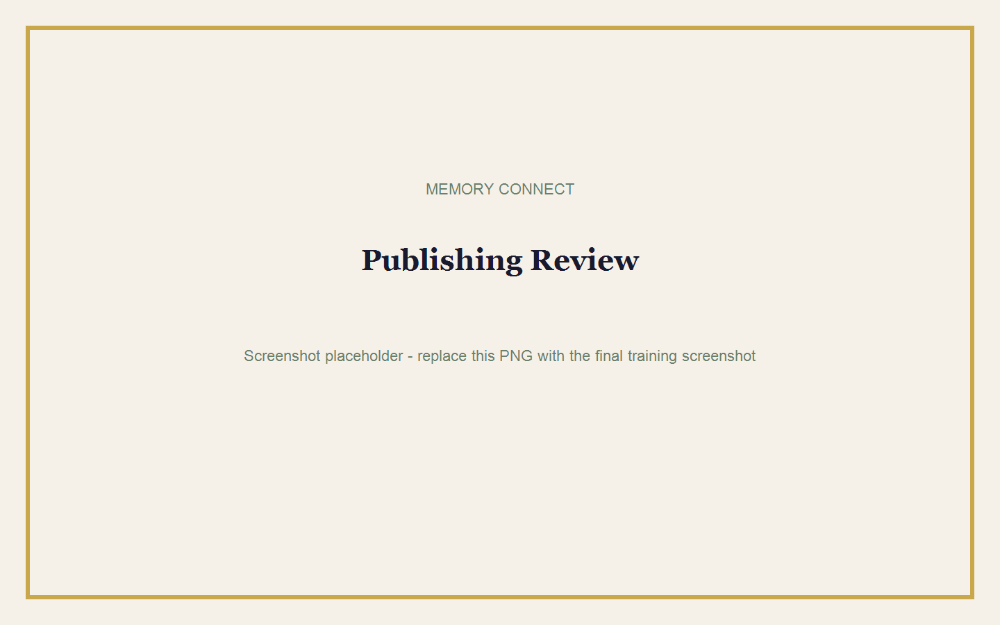
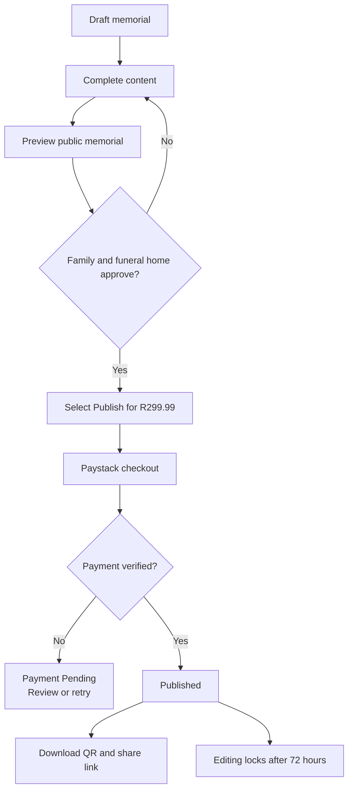
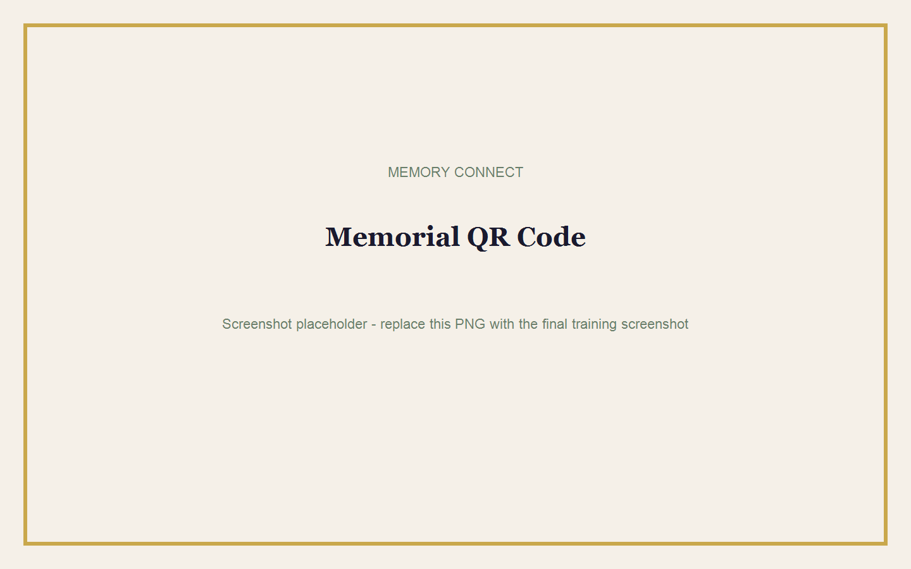

# Publishing a Memorial

## Goal

Complete the final checks, pay securely, publish the memorial, and share it.

**Estimated time:** 10-15 minutes  
**Requirements:** Funeral Home Admin access, completed draft, family approval, and a valid payment method.

## Before You Publish

Check:

- Deceased name and important dates.
- Service date, time, and venue.
- Obituary and biography.
- Programme order and participant names.
- Photo approval and orientation.
- Every map location.
- Funeral home branding and contact details.
- Public preview on phone and computer.

> **Warning:** Editing locks 72 hours after publication. Do not publish incomplete or unapproved content.

## Publishing Flow

## Publish Step by Step

1. Open the completed memorial.
2. Select **Preview public memorial**.
3. Complete the checklist above.
4. Return to the memorial editor.
5. Select **Publish for R299.99**.
6. Complete the Paystack checkout.
7. Wait while Memory Connect verifies the payment.
8. Confirm that the memorial status changes to Published.
9. Open the public memorial link.

## Share the QR Code

1. Find the **QR Code** section.
2. Select **Download QR**.
3. Scan the downloaded code with a phone.
4. Confirm that it opens the correct public memorial.
5. Add the QR code to approved printed programmes, notices, or venue displays.

> **Tip:** Keep clear white space around the QR code. Do not stretch, crop, or place it over a busy photograph.

## After Publishing

| Time | What Happens |
|---|---|
| Immediately | Public link and QR code become available after verified payment. |
| First 72 hours | Authorised funeral home users may make permitted corrections. |
| After 72 hours | The memorial becomes locked for editing. |
| After 30 days | Public viewing ends. |
| After 90 days | The memorial and remaining media are scheduled for permanent deletion. |

## Common Mistakes

- Closing the Paystack window before payment completes.
- Paying twice after a slow confirmation.
- Sharing the preview link instead of the public link.
- Printing a QR code without testing it.
- Waiting until after the lock to request major programme changes.
