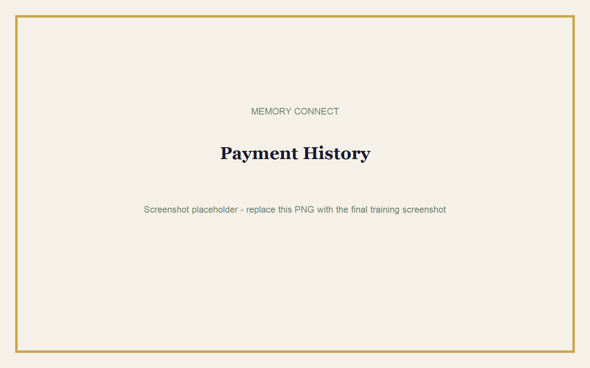
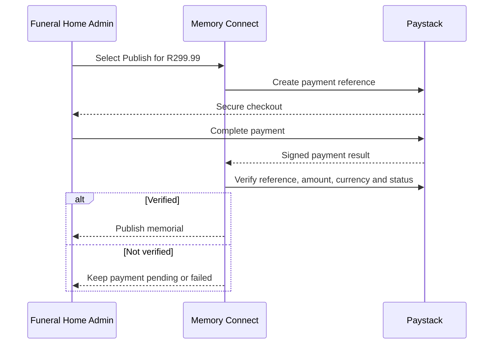

# Payments

## Goal

Understand the publishing charge, complete Paystack checkout, and confirm payment status.

**Estimated time:** 5-10 minutes  
**Requirements:** Funeral Home Admin access, a completed memorial, and a valid payment method.

## Price

Memory Connect charges **R299.99 once per published funeral memorial**.

- Draft creation is free.
- The family does not need billing access.
- The payment enables 30 days of public viewing.
- Payment is processed securely through Paystack.

## Payment Flow

## Make a Payment

1. Open the completed memorial.
2. Select **Publish for R299.99**.
3. Confirm that the Paystack page is secure.
4. Complete the payment instructions.
5. Return to Memory Connect.
6. Wait for payment verification.
7. Confirm Published status.

## Receiving Payment Confirmation

A successful payment record includes:

- Amount and currency.
- Paystack reference.
- Funeral home.
- Memorial.
- Payment status.
- Date paid.

Open **Billing** or **Payments** to review the record.

## Payment Statuses

| Status | Meaning | Action |
|---|---|---|
| Pending | Checkout started but not yet verified | Wait briefly, then review the reference. |
| Success | Payment verified | Confirm the memorial is published. |
| Failed | Paystack did not confirm payment | Check payment details and retry when appropriate. |

> **Warning:** Do not manually mark a payment successful unless you are the platform owner, have verified the payment independently, and accept the audited confirmation.

## Failed Payment

1. Do not immediately repeat the payment.
2. Check whether money was deducted.
3. Record the Paystack reference.
4. Refresh the payment list once.
5. If still pending or failed, contact support with the reference and memorial name.

## Common Mistakes

- Starting payment for the wrong memorial.
- Closing checkout too early.
- Retrying before checking whether the first payment succeeded.
- Sharing payment or card information over WhatsApp.
- Treating a screenshot as proof without checking Paystack status.
