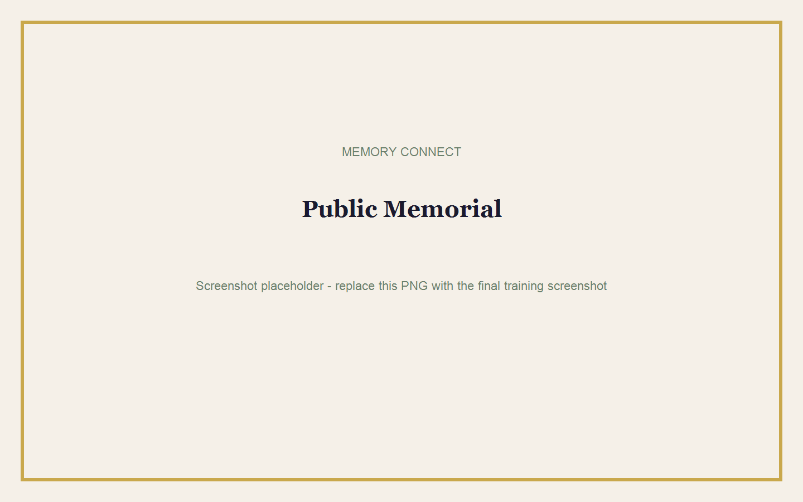

# Public Memorial and QR Code

## Goal

Understand what guests see and share the memorial safely.

**Estimated time:** 10 minutes  
**Requirements:** A published memorial and its public link or QR code.

## What Guests Can See

Depending on the approved content, the public memorial may show:

- Deceased name and photograph.
- Important dates and service information.
- Obituary or biography.
- Funeral programme.
- Announcements.
- Approved photographs.
- Service locations and Google Maps directions.
- Approved tribute messages.
- Funeral home branding and contact details.

Public guests cannot see editing controls, billing, family invitations, Paystack data, or admin routes.

## Share the Memorial

1. Open the published memorial from the admin portal.
2. Copy the public link.
3. Test it in a private browser window.
4. Share it through approved family communication channels.
5. Download and test the QR code before printing.

## Use the QR Code

1. Open the phone camera.
2. Point it at the QR code.
3. Select the link shown by the phone.
4. Confirm the correct deceased name appears.

## Open GPS Directions

1. Scroll to the location section.
2. Choose the correct venue.
3. Select the directions control.
4. Google Maps opens with the saved latitude and longitude.

> **Note:** The guest's phone controls navigation and may ask for location permission.

## Tribute Messages

Guests may submit tribute messages where enabled. Only approved or allowed content appears publicly.

## Public View Counting

Memory Connect counts unique public visitors rather than every page request.

- Repeated refreshes in the same browser do not rapidly increase views.
- The same visitor is counted at most once per memorial per day.
- Another browser or device may count as another visitor.
- Admin and family preview views do not count.

## Unavailable Memorials

If the viewing period ended or the memorial was deleted, guests see a respectful unavailable message. They do not see admin controls or technical details.

## Common Mistakes

- Sharing an admin preview URL.
- Printing a QR code before publication.
- Using a QR code that points to `localhost`.
- Cropping the QR code.
- Assuming public viewing continues after 30 days.
