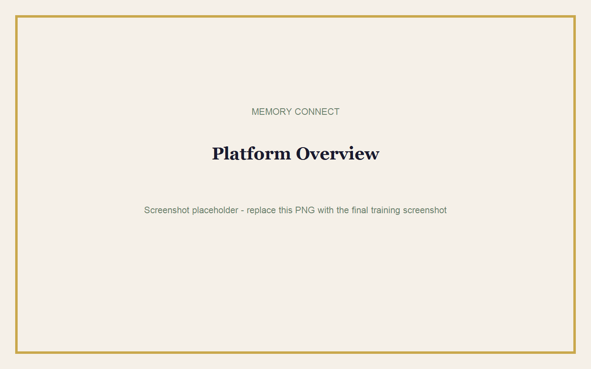
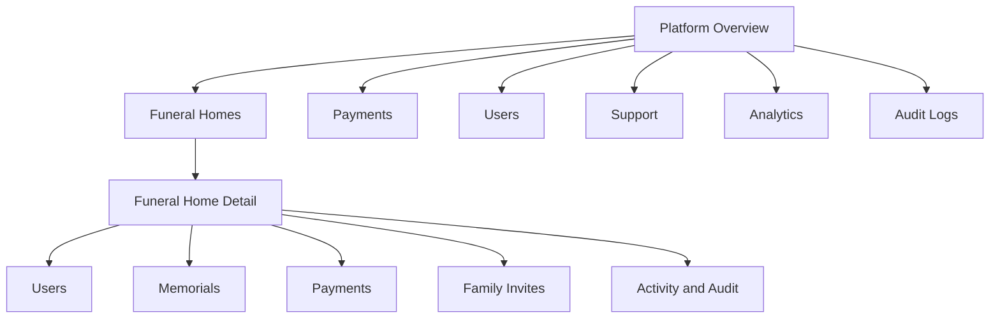
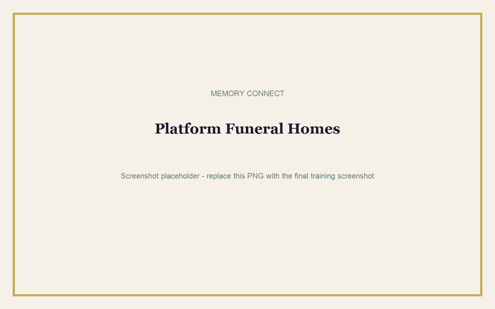
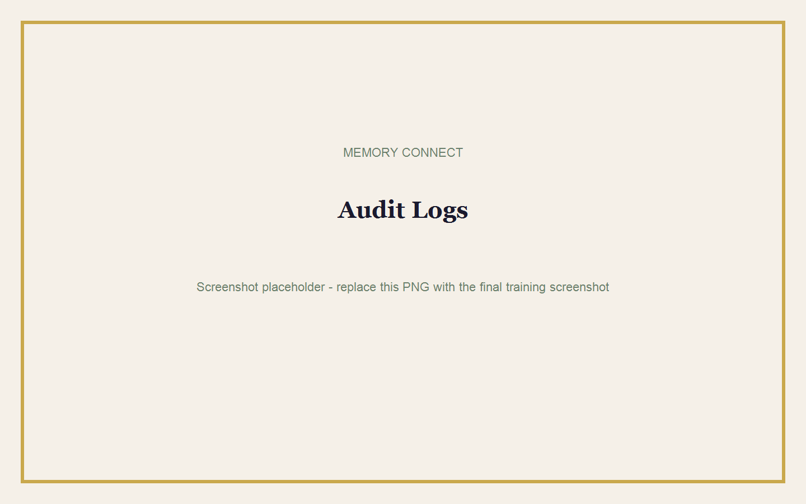

# Owner Platform Guide

## Goal

Monitor Memory Connect as the platform owner and complete sensitive support actions safely.

**Estimated time:** 20 minutes  
**Requirements:** A SUPER_ADMIN account.

> **Warning:** Only SUPER_ADMIN users may access `/admin-owner`. Funeral home and family accounts receive a permission error or are redirected.

## Owner Dashboard Map

## Platform Overview

The overview shows:

- Total funeral homes.
- New registrations today and this month.
- Active, pending, or inactive accounts.
- Total and monthly revenue.
- Successful, failed, and pending payments.
- Total, draft, published, locked, expired, and deleted memorials.
- User and password readiness counts.
- Total public views.

## Viewing Funeral Homes

1. Select **Funeral Homes**.
2. Review the owner, email, phone, registration date, memorial count, payment total, last activity, and status.
3. Select **View details**.
4. Review the funeral home profile, users, memorials, payments, family invitations, branding information, and activity.

Opening a funeral home detail page is written to the platform audit log.

## Suspending or Reactivating a Funeral Home

1. Open the funeral home detail page.
2. Confirm the funeral home name and current status.
3. Select **Suspend** or **Reactivate**.
4. Read the confirmation.
5. Confirm the action.

A suspended funeral home cannot continue using previously issued access tokens. The action is audited.

## Viewing Revenue and Payments

1. Select **Payments**.
2. Review amount, funeral home, memorial, Paystack reference, date, and status.
3. Count revenue only from verified successful payments.

### Manual Payment Verification

1. Independently verify the Paystack reference, amount, currency, and transaction.
2. Open the funeral home detail page.
3. Find the payment.
4. Select **Mark verified**.
5. Read the confirmation carefully.
6. Confirm.

> **Warning:** Manual verification publishes payment status and creates an audit record. Never verify from a screenshot alone.

## User and Password Support

1. Select **Users** or **Support**.
2. Review account role, password status, reset requests, and last login.
3. Select **Send reset link** or **Generate reset link**.
4. Send the secure link to the correct user.

The platform owner can see whether a password is set but can never see the actual password or password hash.

## Invitation Support

1. Open the funeral home detail page.
2. Find **Family invitations**.
3. Confirm the invitee and memorial.
4. Select **Resend invite**.
5. Send the newly generated link.

Old links should no longer be used.

## Support Requests

The Support page shows:

- Open password reset requests.
- Recent failed login attempts.
- Pending family invitations.
- Expired family invitations.
- Users who have not set a password.

## Analytics

Select **Analytics** to review unique views, most-viewed memorials, and top funeral homes by memorial count or verified revenue.

## Audit Logs

Audit records include:

- Actor.
- Action.
- Target.
- Funeral home.
- Date and time.

Audited actions include payment verification, suspension, reactivation, password reset generation, invite resend, memorial deletion, and owner detail viewing.

## Deleting Abusive or Test Memorials

1. Open the correct funeral home.
2. Find the memorial.
3. Confirm the deceased name and reason for removal.
4. Select **Delete**.
5. Read the permanent-deletion warning.
6. Confirm.

> **Warning:** This is a permanent and audited action. Use it only for abusive, unlawful, duplicate, or authorised test content.

## Common Mistakes

- Using a funeral home account instead of SUPER_ADMIN.
- Counting pending payments as revenue.
- Sending a reset link to the wrong email address.
- Manually verifying without checking Paystack.
- Deleting a memorial when suspension or support would solve the issue.
