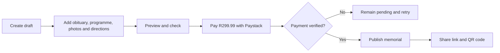

# Memory Connect User Guide

**Version 1.3**

This manual teaches funeral home owners, office administrators, receptionists, staff members, family members, and the Memory Connect platform owner how to use the system.

The instructions use simple language and short steps. Each screenshot area is a replaceable placeholder in [`images/`](images/README.md).

## Welcome

Memory Connect turns funeral information into one respectful digital memorial. Staff can prepare the content, family members can help, and guests can open the final memorial using a link or QR code.

## Who Should Read What?

| Reader | Start Here | Continue With |
|---|---|---|
| New funeral home owner | [Getting Started](01-getting-started.md) | Setup, branding, payments, analytics, Marketing Hub |
| Administrator or receptionist | [Getting Started](01-getting-started.md) | Create a Memorial, Family Management, Publishing |
| Operations staff | [Vehicles & Assets](14-vehicles-and-assets.md) | Funeral Resources |
| Family Manager | [Family Management](05-family-management.md) | Public Memorial |
| Family Contributor | [Family Management](05-family-management.md) | Public Memorial |
| Platform owner | [Owner Dashboard](10-owner-dashboard.md) | Feature Management, Analytics, Troubleshooting |

## Complete Manual

1. [Getting Started](01-getting-started.md)
2. [Funeral Home Setup](02-funeral-home-setup.md)
3. [Branding](03-branding.md)
4. [Create a Memorial](04-create-memorial.md)
5. [Family Management](05-family-management.md)
6. [Publishing](06-publishing.md)
7. [Payments](07-payments.md)
8. [Public Memorial](08-public-memorial.md)
9. [Analytics](09-analytics.md)
10. [Owner Platform Dashboard](10-owner-dashboard.md)
11. [Troubleshooting](11-troubleshooting.md)
12. [Frequently Asked Questions](12-faq.md)
13. [Marketing Hub](13-marketing-hub.md)
14. [Vehicles & Assets](14-vehicles-and-assets.md)
15. [Funeral Resources](15-funeral-resources.md)
16. [Feature Management](16-feature-management.md)

## Quick Reference

| Item | Rule |
|---|---|
| Draft memorial | Free |
| Publishing fee | R299.99 once per memorial |
| Payment provider | Paystack |
| Editing window after publication | 72 hours |
| Public viewing period | 30 days |
| Full retention period | 90 days |
| Family publishing access | Not allowed |
| Password visibility | Passwords are never shown |

## Publishing Flow

## Training Conventions

> **Tip:** A tip suggests an easier or safer way to complete a task.

> **Note:** A note explains useful information that does not require immediate action.

> **Warning:** A warning identifies an action that may affect public content, payment, access, or deletion.

## System Requirements

- A current version of Chrome, Edge, Safari, or Firefox.
- A stable internet connection.
- An email address for account access and password resets.
- A phone, tablet, laptop, or desktop computer.
- Location permission only when using **Use my current location**.
- Suitable JPG, PNG, or supported media files for uploads.

## Training Checklist

- [ ] Log in and log out successfully.
- [ ] Confirm the funeral home profile.
- [ ] Apply branding.
- [ ] Create a draft memorial.
- [ ] Add an obituary and programme.
- [ ] Upload photos.
- [ ] Add service locations.
- [ ] Invite a family member.
- [ ] Preview the public memorial.
- [ ] Complete a test payment before using live payment mode.
- [ ] Download and test the QR code.
- [ ] View analytics.
- [ ] Create a brochure category.
- [ ] Publish a digital brochure with a QR code.
- [ ] Add a vehicle and record its service history.
- [ ] Add an asset and generate its QR code.
- [ ] Reserve vehicles and assets for a memorial.
- [ ] Review the feature registry as platform owner.
- [ ] Enable a feature for one funeral home with an override.
- [ ] Add a feature dependency in Feature Management and confirm the child stays hidden.
