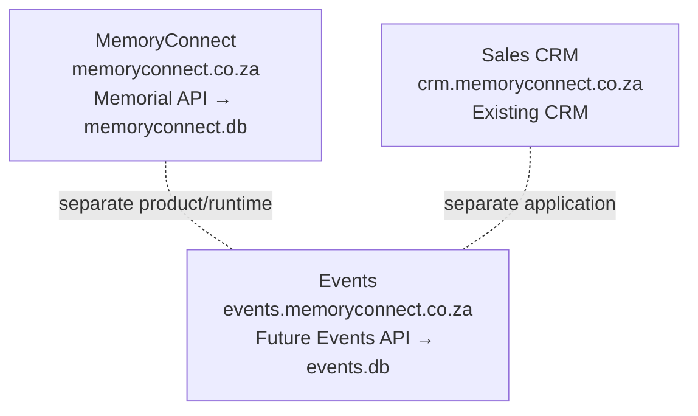

# ADR 001: Events as a Separate Templated Product

Status: Accepted
Date: 2026-09-16

## Principle

> Events is a new product, not a new feature of MemoryConnect.

> Reuse proven patterns, not production data models.

## Context

MemoryConnect (`memoryconnect.co.za`) is a working funeral/memorial product:
funeral homes, digital memorials, funeral programmes, tributes/condolences,
memorial photos, QR codes, and funeral/service information for funeral-home
customers.

The product family under discussion:

- `memoryconnect.co.za` remains the funeral/memorial product.
- `crm.memoryconnect.co.za` remains the internal sales CRM (leads,
  funeral-home prospects, contacts, follow-ups, sales pipeline, customers).
- `events.memoryconnect.co.za` is a future separate product for general
  occasions such as weddings, birthdays, graduations, baby showers,
  anniversaries, family celebrations, corporate events, and community/church
  events.

The reusable concept is not "memorial with different fields." It is a
temporary, shareable event experience:

Organiser → Event → Event Type → Event Content
(Photos, Messages, Agenda, Locations, Gallery, RSVP, Links, QR, Analytics)

Templates determine what the visitor sees, for example:

- WEDDING: Our Story, Wedding Party, Programme, Venue, Photos, RSVP, Messages
- BIRTHDAY: About the Celebrant, Programme, Venue, Photos, Messages
- GRADUATION: Graduate, Achievement, Programme, Venue, Photos, Messages

Memorial remains its own domain model. This assessment was based on inspection
of `apps/api/prisma/schema.prisma`, `apps/api/src/index.ts`,
`apps/api/src/routes/public.ts`, `apps/api/src/lib/publishing.ts`,
`packages/shared/src/index.ts`, `docker-compose.prod.yml`, and `nginx/`.

## Decision

1. Leave production MemoryConnect alone. No Memorial renames, no generic
   `Event` model in the memorial database, no wedding/birthday UI, no URL or
   funeral-home workflow changes.
2. Events will eventually be a generic event platform with templates, not a
   generalized Memorial.
3. Events will eventually have its own API, database, authentication secret,
   uploads/storage, and deployment boundary:

   `events.memoryconnect.co.za` → `events-api.memoryconnect.co.za` → `events.db`

4. Events must NOT introduce an `Event` model into the current memorial
   database.
5. Events must NOT share the current Memorial `Payment`, `MemorialView`, JWT
   secret, uploads volume, or production SQLite database (`memoryconnect.db`).

## Failure boundary

MemoryConnect and Events are independent runtimes/databases. They do not call
each other. CRM is a separate application.

Note: the CRM's current shared database (`CrmLead`/`CrmActivity` inside
`memoryconnect.db`) is existing architecture/technical debt. It is NOT a
pattern to copy for Events.

## Rejected alternatives

- Generalize `Memorial` into `Event` with `eventType`: rejected. It would
  couple funeral retention/billing/slug semantics to unrelated occasions.
- Add `/api/v1/events*` to the existing production API: rejected. It shares
  deploy, DB file, JWT secret, and failure domain with funerals.
- Share `Payment`, `MemorialView`, uploads, or `memoryconnect.db`: rejected.
  Paystack purpose/amount checks and the `(memorialId, visitorHash)`
  uniqueness are memorial-specific.

## Consequences

- When Events is built, it gets a fresh Prisma schema and DB file, its own
  JWT secret, uploads dir, Traefik router, and containers (following the
  existing `smartreach-ai` precedent of a self-contained app with its own DB).
- Reuse by copying proven patterns first (slug + public view, idempotent
  visitor counting, QR/short links, photo/message/location/agenda modules,
  Paystack webhook idempotency, branding templates); extract shared packages
  only after Events stabilizes.
- No application/database/infrastructure changes in this step. This ADR only
  captures the boundary so a future build does not turn Memorial into a
  generic events application.
